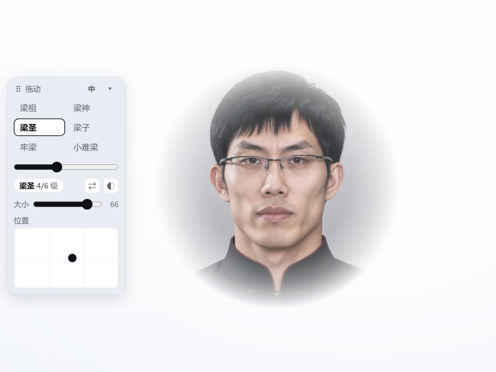
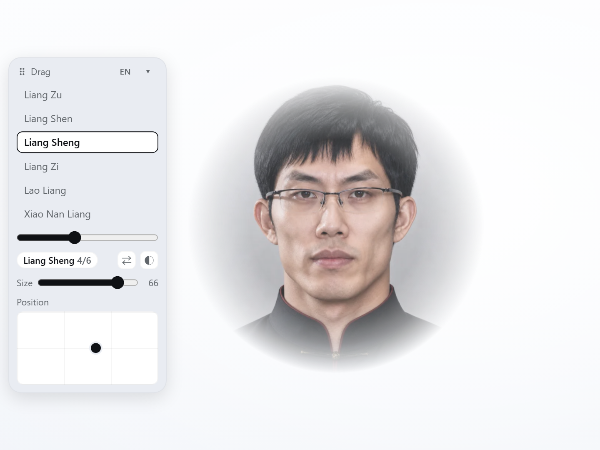

# dsh-liang-backdrop

**[中文](#中文) · [English](#english)**

把「小难梁 → 梁祖」的六张状态图钉在 DeepSeek Harness 窗口里当背景，用一个可拖拽的浮动面板控制等级、大小、位置和浓度。面板自带 **中文 / English** 切换。

Six portraits of the Liang ladder, pinned behind your DSH window and driven by a draggable panel. The panel itself switches between **中文 / English**.

| 中文界面 · Chinese panel | English UI |
|---|---|
|  |  |

- 背景是浮层，`pointer-events: none` 完全穿透，不挡任何点击 · The backdrop is a click-through overlay
- 面板可拖动、可收起，位置和所有设置存在 `localStorage` · Draggable, collapsible, everything persisted
- 切级时交叉淡入，拖动滑杆实时跟手 · Cross-fades between stages, slider tracks the pointer

---

## 中文

### 安装

插件管理面板里添加插件，或命令行：

```bash
dsh plugin --profile desktop add dsh-liang-backdrop
```

安装后重启 DSH（或刷新页面）生效。卸载：

```bash
dsh plugin --profile desktop remove dsh-liang-backdrop
```

### 使用

面板默认贴在窗口左边缘垂直居中。抓手条上的 `⠿` 可以把它拖到任意位置，双击复位。

```
⠿ 拖动                        中  ▾
┌────────┬────────┐
│ 梁祖   │ 梁神   │  ← 六个状态，点谁切谁
│ 梁圣   │ 梁子   │
│ 牢梁   │ 小难梁 │
└────────┴────────┘
━━━━━●━━━━━                     ← 等级滑杆
梁圣 4/6 级             ⇄   ◐
大小 ━━━●━━ 42                  ← 背景尺寸（vmin）
位置 ┌─┬─┬─┐
     │ │ │●┘                    ← 拖小球，背景跟着走
     └─┴─┴─┘
```

| 控件 | 作用 |
|---|---|
| 状态按钮 / 滑杆 | 6 级切换：小难梁 → 牢梁 → 梁子 → 梁圣 → 梁神 → 梁祖 |
| `A` / `中` / `EN` | 面板语言：自动 → 中文 → English |
| `⇄` | 反转方向（默认左 = 梁祖 → 右 = 小难梁） |
| `◐` | 背景浓度：淡 0.35 / 中 0.55 / 浓 0.80 |
| 大小 | 14–76，单位 `vmin`（视口短边的百分比），默认 42 |
| 位置 | 拖动定位画布里的小球，任意位置；中心点按尺寸动态夹取，整张图始终留在窗口内 |
| `▾` / `▸` | 收起 / 展开面板（收起后只剩 `⠿ 梁圣 ▸`） |

窗口宽度小于 640px 或高度小于 520px 时背景自动隐藏。

### 语言

面板右上角那颗很窄的按钮就是语言开关，点一下走一格：

```
A  →  中  →  EN  →  A …
自动    中文    English   回到自动
```

- **自动**：跟随 DSH 的语言设置（`设置 → 通用 → 语言`），切换 DSH 语言时面板立刻跟着变
- **中文 / English**：固定面板语言，覆盖 DSH 的全局设置，适合系统是英文但想用中文名字，或者反过来
- 选择存在 `localStorage`，刷新、重启都记得

六级状态名在两种语言下的对照（英文界面保留拼音，这些梗翻译就没了；右侧是原意）：

| 等级 | 中文 | English | 含义 |
|---|---|---|---|
| 1 | 小难梁 | Xiao Nan Liang | 刚入门的梁 |
| 2 | 牢梁 | Lao Liang | 被关起来的梁 |
| 3 | 梁子 | Liang Zi | 「结梁子」的梁 |
| 4 | 梁圣 | Liang Sheng | 封圣的梁 |
| 5 | 梁神 | Liang Shen | 封神的梁 |
| 6 | 梁祖 | Liang Zu | 祖宗的梁 |

拼音比中文名长，所以英文面板会把六个状态排成一列（面板也略宽一点），中文面板仍是两列。

### 数据

所有设置存在 `localStorage` 的 `dsh.liang-backdrop:v1`：

```json
{ "level": 3, "reverse": true, "strength": 1, "size": 42,
  "px": 0.5, "py": 0.5, "collapsed": false, "x": null, "y": null,
  "lang": "auto" }
```

`px` / `py` 是图片中心在窗口里的比例坐标，`x` / `y` 是控制面板的像素坐标（`null` = 默认位置），`lang` 是 `auto` / `zh` / `en`。老版本没有 `lang` 字段时按 `auto` 处理。

### 素材与授权

本包**不打包任何图片**。运行时按需从
[Lichtspektrum/liang-intensity-calibrator](https://github.com/Lichtspektrum/liang-intensity-calibrator)
的 `public/frames` 下载 6 张关键帧，缓存在安装目录的 `.frames-cache/`；如果开发目录里有 `assets/frames/`，优先用本地的。

那个项目的**源码**是 MIT，但人像素材**不随 MIT 共享**，其 README 明确要求复用或二次发布前确认肖像与素材使用权。所以：

- 本包 tarball 只有代码（`files` 排除了 `assets/frames`）
- README 里的截图运行时也用的是这六张上游演示图，仅作界面示意
- 想完全摆脱上游图床，把 `index.js` 里的 `FRAME_SOURCE` 换成你自己的 6 张方图即可

代码用 [MIT](LICENSE) 发布；素材归属与限制见 [NOTICE](NOTICE)。

### 结构

| 文件 | 作用 |
|---|---|
| `client.js` | 两处挂载：`shell.overlay` 的 `liang-backdrop`（背景）、`liang-backdrop-control`（面板）；中英词典与语言开关都在这里 |
| `index.js` | Host 端 `webServer` 前缀路由 `/plugins/liang-backdrop/frames` |
| `cordis.patch.yml` | 插入 `liang-backdrop` 插件行 |
| `icon.svg` / `locale/*.json` | 插件市场图标与中英文元数据 |
| `screenshots/` | README 用的中英文界面图 |
| `_tools/preview/` | 截图工具：把真实的 `client.js` 跑在空页面里，用无头 Chrome 出图 |

重新出图：把 React 18 UMD 放进 `_tools/preview/vendor/`，然后 `node _tools/preview/shoot.mjs`。

---

## English

### Install

Add it from the plugin marketplace, or:

```bash
dsh plugin --profile desktop add dsh-liang-backdrop
```

Restart DSH (or reload the page). Remove with:

```bash
dsh plugin --profile desktop remove dsh-liang-backdrop
```

### Usage

The panel opens against the left edge, vertically centred. Drag it by the `⠿` grip, double-click to reset.

```
⠿ Drag                            A  ▾
┌──────────────┐
│ Liang Zu     │  ← six stages, click to switch
│ Liang Shen   │
│ Liang Sheng  │
│ Liang Zi     │
│ Lao Liang    │
│ Xiao Nan Liang│
└──────────────┘
━━━━━●━━━━━                          ← level slider
Liang Sheng 4/6            ⇄  ◐
Size ━━━●━━ 42                       ← backdrop size (vmin)
Position ┌─┬─┬─┐
         │ │ │●┘                    ← drag the knob, the portrait follows
         └─┴─┴─┘
```

| Control | What it does |
|---|---|
| Stage chips / slider | Six stages: Xiao Nan Liang → Lao Liang → Liang Zi → Liang Sheng → Liang Shen → Liang Zu |
| `A` / `中` / `EN` | Panel language: Auto → 中文 → English |
| `⇄` | Reverse the order (top = Liang Zu, bottom = Xiao Nan Liang by default) |
| `◐` | Backdrop strength: faint 0.35 / medium 0.55 / strong 0.80 |
| Size | 14–76 in `vmin` (% of the viewport's short side), default 42 |
| Position | Drag the knob anywhere; the centre is clamped by size so the portrait always stays on screen |
| `▾` / `▸` | Collapse / expand (collapsed shows just `⠿ Liang Sheng ▸`) |

The backdrop hides itself below 640 px width or 520 px height.

### Language

The narrow button in the panel header cycles the panel language:

```
A  →  中  →  EN  →  A …
Auto    中文    English   back to Auto
```

- **Auto** follows the DSH language (`Settings → General → Language`) and updates live when you switch it
- **中文 / English** pins the panel language and overrides the global setting — handy when the app is in English but you want the original Chinese names, or the other way round
- The choice is stored in `localStorage`, so it survives reloads and restarts

Stage names stay in pinyin in the English UI — the puns do not survive translation — so the English panel lists them in one column instead of two:

| Level | 中文 | English | Meaning |
|---|---|---|---|
| 1 | 小难梁 | Xiao Nan Liang | the rookie |
| 2 | 牢梁 | Lao Liang | locked up |
| 3 | 梁子 | Liang Zi | "to hold a grudge" |
| 4 | 梁圣 | Liang Sheng | canonised |
| 5 | 梁神 | Liang Shen | deified |
| 6 | 梁祖 | Liang Zu | the patriarch |

### Stored state

Everything lives in `localStorage` under `dsh.liang-backdrop:v1`:

```json
{ "level": 3, "reverse": true, "strength": 1, "size": 42,
  "px": 0.5, "py": 0.5, "collapsed": false, "x": null, "y": null,
  "lang": "auto" }
```

`px` / `py` are the portrait centre as fractions of the viewport, `x` / `y` the panel position in pixels (`null` = default), and `lang` is `auto` / `zh` / `en`. Older entries without `lang` are read as `auto`.

### Assets & license

This package **ships no images**. At runtime it fetches the six keyframes from
[Lichtspektrum/liang-intensity-calibrator](https://github.com/Lichtspektrum/liang-intensity-calibrator)'s
`public/frames` and caches them in `.frames-cache/` next to the install; a dev checkout with `assets/frames/` is preferred.

That project's **source** is MIT, but the portraits are **not** covered by it — its README asks you to clear portrait/material rights before reuse or redistribution. Therefore:

- the tarball contains code only (`files` excludes `assets/frames`)
- the README screenshots also show those six upstream demo portraits, purely as UI illustrations
- to drop the upstream host entirely, point `FRAME_SOURCE` in `index.js` at your own six square images

Code is released under [MIT](LICENSE); asset attribution and limits are in [NOTICE](NOTICE).

### Files

| File | Purpose |
|---|---|
| `client.js` | Mounts the overlay (`liang-backdrop`) and the panel (`liang-backdrop-control`); holds both dictionaries and the language switch |
| `index.js` | Host `webServer` prefix route `/plugins/liang-backdrop/frames` |
| `cordis.patch.yml` | Inserts the `liang-backdrop` plugin row |
| `icon.svg` / `locale/*.json` | Marketplace icon and zh/en metadata |
| `screenshots/` | Chinese and English UI shots used by this README |
| `_tools/preview/` | Screenshot tooling: runs the real `client.js` in a bare page and captures it with headless Chrome |

To regenerate them: drop React 18 UMD into `_tools/preview/vendor/`, then run `node _tools/preview/shoot.mjs`.
